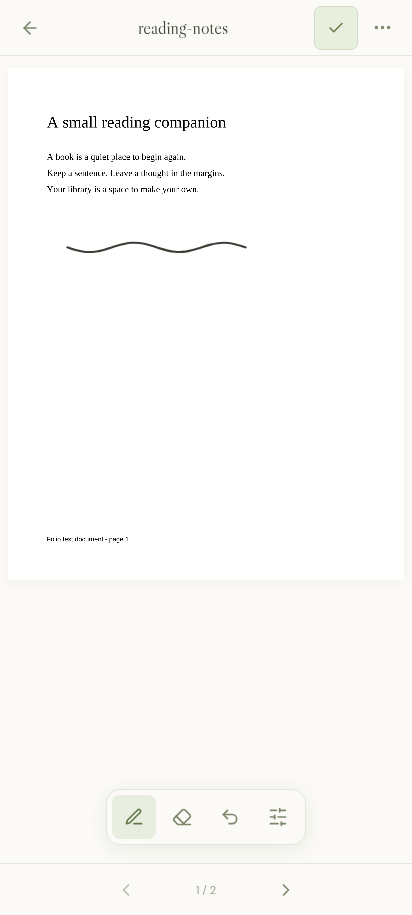

# Folio

A quiet, self-hosted home for your books and the thoughts they leave behind.

Folio is a web-first, single-user reader for **DRM-free EPUB and PDF** files. Your books, reading positions, highlights, and notes live on your own server. It is licensed under AGPL-3.0-only.


## What works today

- Upload multiple EPUBs and PDFs, with drag and drop and a 100 MiB per-file limit.
- Read paginated EPUBs and PDFs with selectable text, bookmarks, font/zoom controls, a dark theme, and saved reading positions.
- Write on PDFs with a pressure-sensitive pen, translucent highlighter, stroke eraser, colors, thickness controls, and undo/redo. Ink saves automatically and scales with the page.
- Highlight passages in four colors, add and edit notes, jump back to passages, and export your notebook as Markdown.
- Organize books into collections, save favorites, update titles/authors, and track reading status.
- Search, sort, and switch between a cover grid and list. The interface adapts to phones and tablets.
- Extract EPUB metadata and raster covers. Books without a cover receive a generated typographic cover.
- Optional password sign-in and bearer-token API access. No cloud account, analytics, or runtime CDN dependencies.
- Add six optional, clearly labeled public-domain sample **excerpts**, not full books.

## Self-host with Docker

```sh
cp .env.example .env
# Edit .env and set a long, unique FOLIO_PASSWORD.
docker compose up -d --build
```

Open **http://localhost:8080**. The default Compose setup binds to loopback. Put an HTTPS reverse proxy in front of it for remote access, preserve the original `Host` header, and set `FOLIO_SECURE_COOKIE=true` when using HTTPS. Allow request bodies of at least 101 MiB at the proxy.

For access from other devices on your home network, follow the [homelab deployment guide](docs/HOMELAB.md). Compose host binding and port are configurable with `FOLIO_BIND_ADDR` and `FOLIO_PORT`; the defaults remain `127.0.0.1:8080`.

The `folio-data` named volume contains the SQLite database and original books. The image runs as an unprivileged user with a read-only root filesystem. A fresh instance starts empty; choose the sample library from the empty state or library settings to explore.

To use a bind mount instead of a named volume, make the data directory writable by UID/GID `65532:65532`.

## Run from source

Requires **Go 1.24+**, **Node.js 24+**, and npm. SQLite is compiled into the Go binary; no database service or C toolchain is needed for a production build.

```sh
make build
./bin/folio
```

For hot frontend development, run these in separate terminals from the repository root:

```sh
go run ./cmd/folio
```

```sh
cd web
npm ci
npm run dev
```

Open http://localhost:5173. Vite proxies `/api` to Go on `127.0.0.1:8080`. The production Go process serves the built frontend itself.

| Setting | Default | Meaning |
| --- | --- | --- |
| `FOLIO_ADDR` / `-addr` | `127.0.0.1:8080` | HTTP listen address |
| `FOLIO_DATA` / `-data` | `data` | SQLite database, covers, and book files |
| `FOLIO_WEB` / `-web` | `web/dist` | Built frontend directory |
| `FOLIO_PASSWORD` | empty | Library password; empty enables trusted-network mode |
| `FOLIO_API_TOKEN` | empty | Optional bearer token for scripts and future clients |
| `FOLIO_SECURE_COOKIE` | `false` | Require HTTPS for the session cookie |

Password changes invalidate existing sessions. Sign-out removes the current browser's cookie. Use a strong password and HTTPS outside your trusted network; anyone with access to this single-user instance shares its library.

## Architecture

```text
React + TypeScript web app
  ├── EPUB.js: reflowable EPUBs and CFI highlights
  ├── PDF.js: page rendering and selectable text
  └── /api/v1 JSON + multipart + HTTP range requests
        └── Go net/http server
              ├── SQLite (WAL): metadata, collections, progress, annotations
              └── filesystem: original books and extracted covers
```

Go keeps deployment small and makes the backend usable by future native clients. TypeScript fits browser reading engines and gives the frontend typed data models. SQLite suits a personal, self-hosted library without an external database. PDF highlights use normalized page rectangles; EPUB highlights use CFIs, so they can be rendered by another client. APIs and storage are separate from presentation.

See [API documentation](docs/API.md) for requests and annotation formats, and [contributing](CONTRIBUTING.md) for development checks.

## Handwriting on PDFs



Open a PDF and tap the **Write** button. The floating dock keeps the drawing tool, whole-stroke eraser, undo, and **Pen options** within reach. Pen options contains the pen/highlighter choice, color, thickness, finger drawing, and redo. Tap **Done** to return to text selection. `Ctrl/Cmd Z`, `Ctrl/Cmd Shift Z`, and `Ctrl Y` also work while writing. Histories are per page and last for the current reading session.

The header's **More** button contains navigation, notes, bookmarks, page zoom/text size, and appearance. Tap the page number to jump to another page. Saving indicators appear only while loading/saving; errors and recovery actions stay visible until resolved.

Phone PDFs use a 2048-pixel-wide raster baseline where the page's shape permits it. The renderer responds to device pixel density and refreshes after browser pinch zoom, with a 16-megapixel/8192-pixel-side canvas limit to bound memory. Resolution-only refreshes retain the visible bitmap until its replacement is ready and preserve text selection and vector ink. This improves rendering detail; it does not add information to a low-resolution image embedded in an original PDF.

Pens and mice can draw immediately. Fingers drag the document to scroll; enable **Finger drawing** in pen options to sketch with touch. Touches during an active pen stroke and shortly afterward are ignored to reduce accidental palm marks. Initial handwriting has been user-tested on a Galaxy S25 Ultra. Pressure, palm rejection, latency, and other devices/browser combinations still need device testing.

Writes are serialized per page, including when you turn pages while a save is in flight. Failed saves leave strokes visible and offer retry and a JSON recovery copy. A stale tab is stopped with a revision-conflict message instead of overwriting newer ink; download its recovery copy before reloading the saved page. Leaving the reader waits for pending saves, and closing/reloading the tab warns about unsaved changes. Keep the tab open until a save succeeds or you have downloaded a copy.

This first version stores editable ink in SQLite and leaves the original PDF unchanged. **Download book** still downloads the original; embedding ink into an exported PDF is a later feature. Markdown notebook exports contain text notes/highlights, not handwriting. A recovery JSON includes page number and vector strokes for the ink API, not a rendered PDF. Backups of the data directory include handwriting.

## Backups

Stop Folio before copying the **entire data directory or Docker volume**, then restart it. Include `folio.db`, any `folio.db-wal`/`folio.db-shm` files, and `books/`. Restore them together with the same filesystem ownership. Do not copy only the database while the application is running. Markdown notebook export complements a backup; it does not include book files or annotation coordinates.

## Current scope

This is an initial working release, not a complete Apple Books replacement. It has one shared library per server, online reading, and EPUB/PDF support. It does not yet include individual user accounts, offline/PWA storage, full-text search, OPDS/Calibre integration, OCR, audiobooks, DRM removal, MOBI/AZW support, or native clients. Scanned PDFs without a text layer can be read and bookmarked but cannot have text highlights. Password-encrypted PDFs are not currently supported. Original PDFs and EPUBs are unchanged; annotations are stored separately, not embedded into exported books.

Next priorities are accessibility and cross-browser hardening, larger-library indexing and pagination, offline caching, multi-user libraries and scoped tokens, then native clients using the same API. The current API is versioned but may evolve before a stable 1.0 release.

## License and attribution

[AGPL-3.0-only](LICENSE). See [THIRD_PARTY.md](THIRD_PARTY.md) for reading engines, fonts, sample text, and license information. Folio is independent and is not affiliated with Apple.
